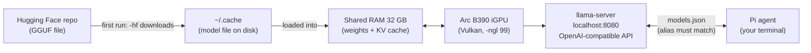
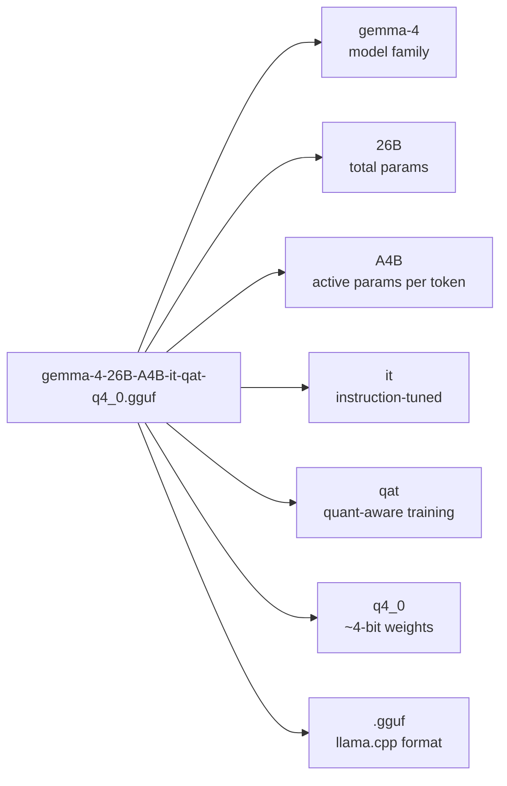
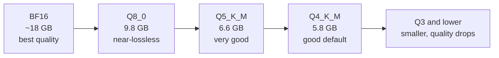
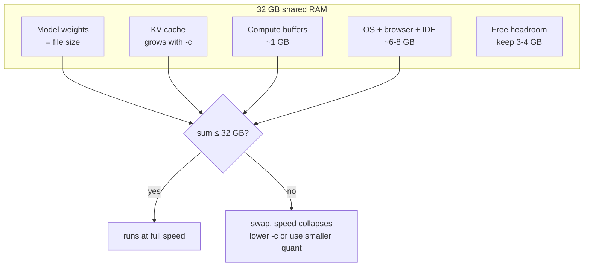
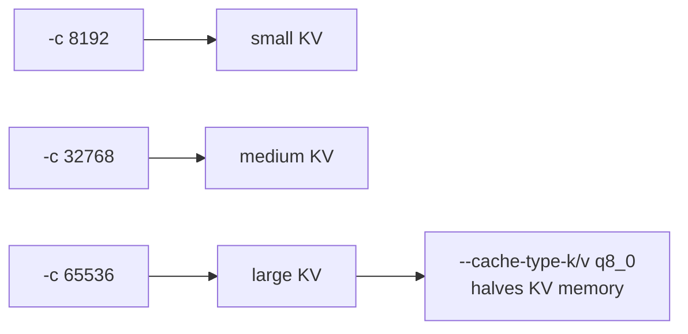
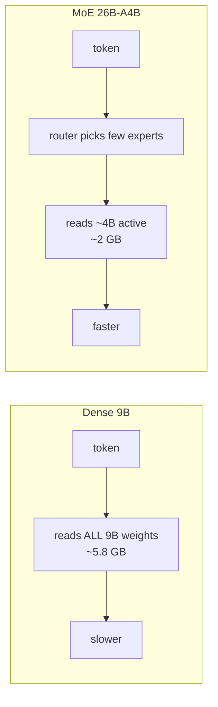
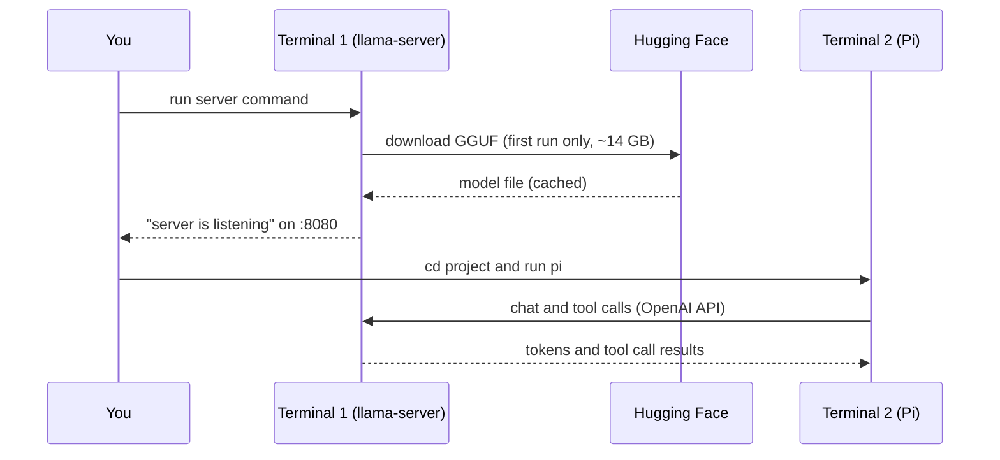
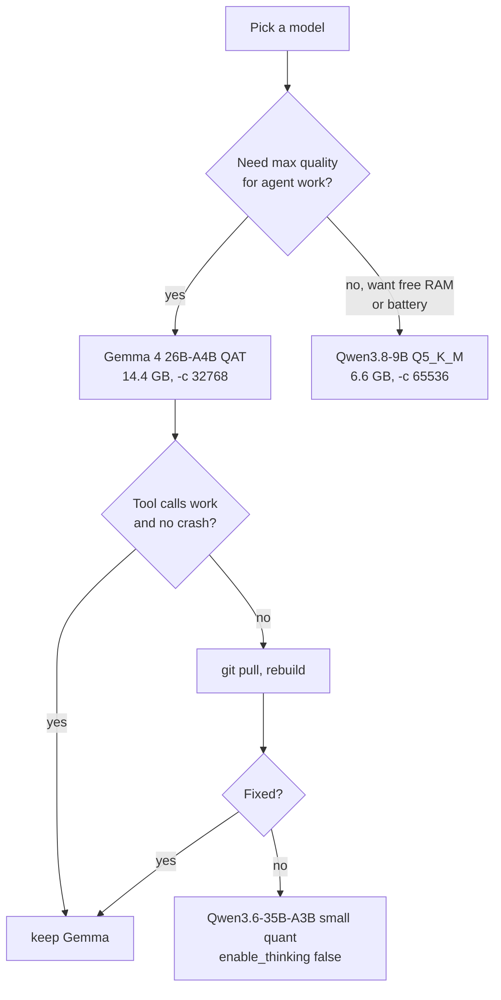
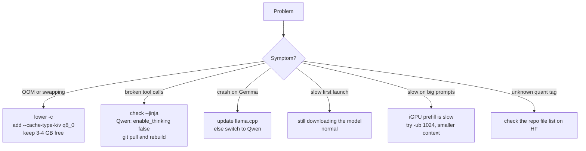

# Local LLM cheat sheet (llama.cpp + Pi, 32 GB laptop)

TODO: vllm

## 0. Big picture


## 1. Terms
| Term | Meaning |
|---|---|
| **9B / 26B** | Number of parameters (weights). More = more knowledge, more memory. |
| **GGUF** | llama.cpp's single-file model format (weights + tokenizer + chat template). |
| **Quantization (Q4, Q5, Q8)** | Store weights in fewer bits: smaller file, faster, small quality loss. |
| **K / M** | `K` = k-quant block scheme, `M` = medium (sensitive layers kept higher precision). `_0` = older simple scheme. |
| **QAT** | Quantization-Aware Training: model trained to survive Q4, so it loses less quality. |
| **BF16 / FP16** | Unquantized, 16 bits per weight. |
| **MoE (e.g. 26B-A4B)** | Whole model in RAM, but only ~4B "active" parameters run per token. |
| **Dense** | All parameters used for every token (slower for the same size). |
| **Context (`-c`)** | Tokens the model sees at once (prompt + files + history + output). |
| **KV cache** | Per-token attention memory. Grows with context. |

Reading a model name:


## 2. File size formula
`file size ≈ parameters × bits per weight ÷ 8`

Example, 9B model:
- BF16 (16 bit): ~18 GB
- Q8_0 (~8.7 bpw): 9.79 GB
- Q5_K_M (~5.9 bpw): 6.64 GB
- Q4_K_M (~5.1 bpw): 5.78 GB

Gemma 4 26B-A4B QAT Q4_0: 14.44 GB (25.2B params, ~4.6 bpw).


Left = bigger and better, right = smaller and faster.

## 3. RAM budget (shared memory on iGPU, no separate VRAM)
`weights (file size) + KV cache + ~1 GB buffers + OS/apps (~6-8 GB) <= total RAM`



**KV cache (rough):** `2 x layers x kv_heads x head_dim x bytes x tokens`
- Hypothetical: 36 layers, 8 KV heads, head_dim 128, fp16 = ~147 KB/token, so 65K tokens = ~9.7 GB.
- Newer models (Qwen 3.5/3.6, Gemma 4) use hybrid/sliding attention, so real KV is often much smaller.
- Check the real number in the server log: `KV buffer size`.



## 4. Speed (generation is memory-bandwidth-bound)
`tok/s <= memory bandwidth / bytes read per token`

Your machine (estimate): 7467 MT/s x 128-bit = ~120 GB/s.
- Dense 9B Q4 (5.8 GB/token): <= ~20 tok/s
- MoE 26B-A4B (~2 GB/token active): <= ~60 tok/s
- Real numbers are lower. Measure: `llama-bench -hf <repo> -ngl 99 -p 1024 -n 128`



Prompt processing (prefill) is compute-bound and slower on an iGPU.

## 5. Flags
| Flag | Purpose |
|---|---|
| `-hf repo:QUANT` | Download from Hugging Face on first run, then use the cache. |
| `-m file.gguf` | Use a local GGUF file. |
| `-c 32768` | Context window. Bigger = more KV RAM. |
| `-ngl 99` | Offload (up to) all layers to the GPU. |
| `--flash-attn on` | Faster, lower-memory attention. |
| `--cache-type-k q8_0 --cache-type-v q8_0` | Quantize the KV cache, ~half memory, small quality cost. |
| `-np 1` | One parallel slot (more slots split the context). |
| `--jinja` | Use the model's chat template (needed for tool calls). |
| `--alias name` | Model id exposed by the API (must match Pi's models.json). |
| `--chat-template-kwargs '{"enable_thinking":false}'` | Qwen 3.x: disable thinking. No space after the colon. |
| `-ub / -b` | Batch sizes, tune only for speed. |

## 6. Setup
```bash
# build llama.cpp (Vulkan) or download a release binary
sudo apt install -y git cmake build-essential libvulkan-dev glslc libcurl4-openssl-dev vulkan-tools nodejs npm
git clone https://github.com/ggml-org/llama.cpp ~/llama.cpp && cd ~/llama.cpp
cmake -B build -DGGML_VULKAN=ON && cmake --build build --config Release -j

# Pi
npm install -g @earendil-works/pi-coding-agent
```

`~/.pi/agent/models.json`:
```json
{"providers":{"llama-cpp":{"baseUrl":"http://localhost:8080/v1","api":"openai-completions","apiKey":"none",
"models":[{"id":"gemma4"},{"id":"qwen38-9b"}]}}}
```

Run (terminal 1), then Pi (terminal 2):
```bash
~/llama.cpp/build/bin/llama-server -hf google/gemma-4-26B-A4B-it-qat-q4_0-gguf \
  --alias gemma4 --jinja -ngl 99 -c 32768 -np 1 --flash-attn on --host 127.0.0.1 --port 8080
cd ~/project && pi
```



## 7. Model picks for 32 GB (Core Ultra X7 358H, Arc B390)
1. **Default:** `google/gemma-4-26B-A4B-it-qat-q4_0-gguf` (14.4 GB, MoE, official).
2. **Alternative:** Qwen3.6-35B-A3B in a smaller quant (UD-Q3_K_XL or IQ4_XS), `-c 16384`.
3. **Light backup:** community Qwen3.8-9B distill, Q5_K_M (6.6 GB), `-c 65536` is fine.
4. Avoid dense 27B+ (too slow) and uncensored fine-tunes for agent work (tool calls can degrade).



## 8. Troubleshooting


## 9. Sources
- GGUF spec: https://github.com/ggml-org/ggml/blob/master/docs/gguf.md
- llama.cpp build: https://github.com/ggml-org/llama.cpp/blob/master/docs/build.md
- SYCL backend (Intel): https://github.com/ggml-org/llama.cpp/blob/master/docs/backend/SYCL.md
- Local agents with llama.cpp + Pi: https://huggingface.co/docs/hub/agents-local
- Gemma 4 QAT GGUF: https://huggingface.co/google/gemma-4-26B-A4B-it-qat-q4_0-gguf
- Qwen3.8-9B GGUF (community): https://huggingface.co/empero-ai/Qwen3.8-9B-GGUF
- PagedAttention / KV cache: https://arxiv.org/abs/2309.06180
- FlashAttention: https://arxiv.org/abs/2205.14135
- Mixture of experts: https://arxiv.org/abs/1701.06538
- LLM.int8() quantization: https://arxiv.org/abs/2208.07339
- Mermaid syntax: https://mermaid.js.org/intro/
